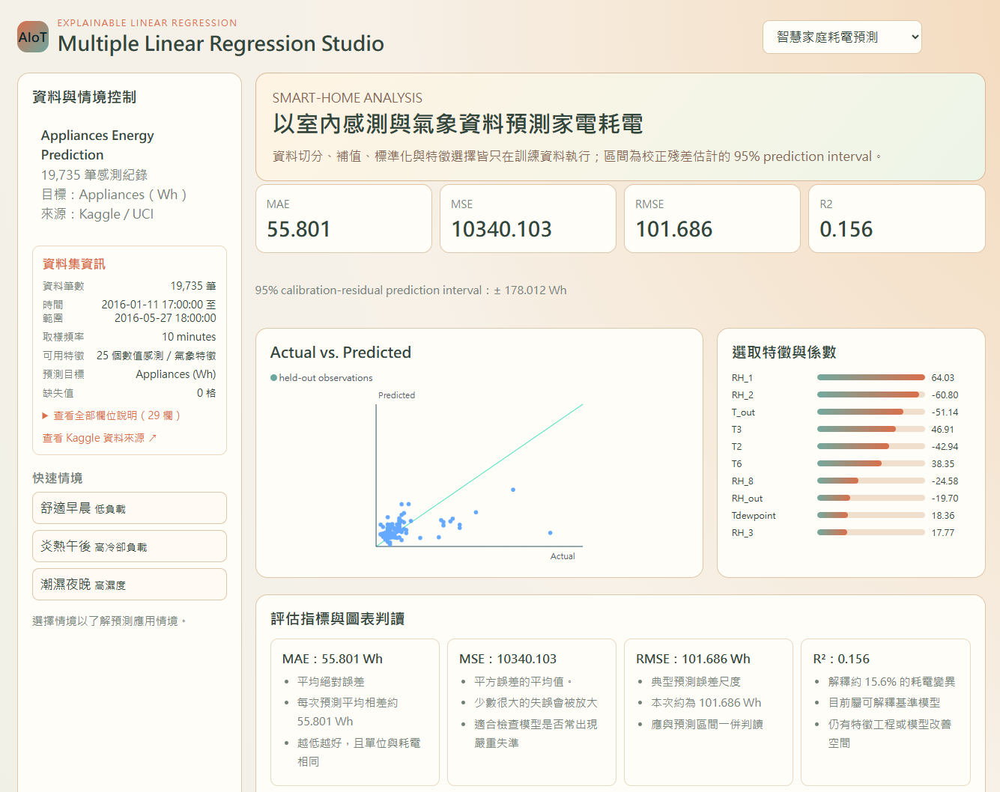

# IoT Regression Studio

以可解釋的多元線性回歸，預測智慧家庭家電耗電量的互動式儀表板。本專案為 AIoT HW02 作業，將 CRISP-DM 流程、資料集說明、模型訓練、模型評估與情境化預測整合在同一個 FastAPI 網站中

---

## Live Demo
https://aiot-hw-02.vercel.app/


## 功能一覽

- **智慧家庭耗電預測**：以 Appliances Energy Prediction 資料集預測 `Appliances` 家電耗電量（Wh）
- **互動式儀表板**：呈現 MAE、MSE、RMSE、R²、95% 預測區間、Actual vs. Predicted 散點圖與特徵標準化係數
- **模型結果解讀**：列出影響幅度最大的特徵與 Top 3 特徵，並說明其對應的室內感測或戶外氣象欄位
- **資料集導覽**：可在側欄展開查看資料筆數、時間範圍、取樣頻率、缺失值與所有欄位說明
- **三種情境預測**：舒適早晨、炎熱午後、潮濕夜晚會以資料集中相對應條件的中位數感測值產生預測結果
- **自訂 CSV 回歸**：上傳最多 25 MB 的 CSV，選擇連續數值目標欄位後執行相同的分析流程
- **CRISP-DM 對照**：以流程圖與六階段內容說明本專案的資料探勘流程

## 資料集

主要案例採用 [Appliances Energy Prediction（Kaggle）](https://www.kaggle.com/datasets/loveall/appliances-energy-prediction)，原始資料來源為 [UCI Machine Learning Repository](https://archive.ics.uci.edu/dataset/374/appliancesenergyprediction)

| 項目 | 說明 |
| --- | --- |
| 預測目標 | `Appliances`，家電耗電量（Wh） |
| 紀錄數 | 19,735 筆 |
| 取樣頻率 | 每 10 分鐘一筆 |
| 資料期間 | 2016-01-11 至 2016-05-27 |
| 主要欄位 | 室內各房間溫度／相對濕度、戶外溫濕度、風速、氣壓、能見度與照明耗電 |

請下載資料後放在專案根目錄，檔名必須為：

```text
KAG_energydata_complete.csv
```

分析主要資料集時，會將 `date`、`rv1`、`rv2` 排除：前者是原始時間字串，後兩者為資料集中的隨機測試變數。頁面上的「資料集資訊」可查看每個欄位的中文意義

## 模型與評估方法

資料會先移除沒有目標值的列，並以固定亂數種子切分為訓練集、校正集與測試集。所有前處理只在訓練集擬合，以降低資料洩漏風險

1. 使用中位數補值處理數值欄位缺失值
2. 使用 `StandardScaler` 將特徵標準化
3. 使用 `SelectKBest(f_regression)` 依 F-score 選取最多 20 個數值特徵
4. 使用 `LinearRegression` 訓練多元線性回歸模型
5. 以校正集殘差的 95% 分位數估計預測區間
6. 在未參與訓練的測試集上計算 MAE、MSE、RMSE 與 R²

儀表板的係數是「標準化後的特徵係數」：在其他變數維持不變的模型假設下，某特徵增加一個訓練集標準差時，預測耗電量改變的 Wh 數。係數絕對值越大，代表該特徵在此線性模型中的影響幅度越高

## 儀表板區塊說明

| 區塊 | 呈現內容 |
| --- | --- |
| 資料與情境控制 | 資料來源、資料集資訊、欄位說明與三種情境按鈕 |
| 情境預測 | 所選情境下的預測耗電與 95% 預測區間 |
| 評估指標 | MAE、MSE、RMSE、R² 與其數值意義 |
| Actual vs. Predicted | 測試資料的實際值與預測值；點越接近對角線代表誤差越小 |
| 選取特徵與係數 | 依係數絕對值排序的前 10 個選取特徵；正負號表示模型中的關聯方向 |
| 模型結果解讀 | 影響幅度最大的特徵、Top 3 特徵、欄位含義與模型限制 |
| CRISP-DM 分析流程 | Business、Data、Preparation、Modeling、Evaluation、Deployment 的流程圖與專案對照 |

## 專案結構

```text
.
├── app.py                         # FastAPI 路由、資料處理與回歸分析
├── static/
│   ├── index.html                 # 儀表板基本結構與圖表渲染
│   └── blob-upload.js             # 儀表板說明、Vercel Blob 上傳與情境預測互動
├── api/blob-upload.js             # Vercel Blob client upload token handler
├── KAG_energydata_complete.csv    # 主要資料集（需自行下載）
├── requirements.txt               # Python 套件版本
├── package.json                   # Vercel Blob client 相依套件
├── vercel.json                    # Vercel Function 設定
└── .python-version                # 專案使用的 Python 版本
```

## 本機執行

需求：Python 3.12 (建議使用專案專屬虛擬環境，避免影響全域 Python 設定)

```powershell
py -3.12 -m venv .venv
.\.venv\Scripts\Activate.ps1
python -m pip install -r requirements.txt
python -m uvicorn app:app --reload
```

開啟 <http://127.0.0.1:8000>

若 PowerShell 因執行政策拒絕啟用虛擬環境，可只在目前終端機暫時允許：

```powershell
Set-ExecutionPolicy -Scope Process -ExecutionPolicy Bypass
.\.venv\Scripts\Activate.ps1
```

## 自訂 CSV 使用條件

- 檔案必須是 `.csv`，且大小不可超過 **25 MB**
- 使用者選擇的目標欄位必須是連續數值欄位
- 至少需要 15 筆具有目標值的資料
- 至少需要 1 個可用的數值預測欄位
- 名稱為 `id`、`index` 或以 `_id` 結尾的欄位會自動排除
- 目前不會自動處理類別型文字欄位；請先自行編碼或只使用數值特徵

## API 摘要

| 方法 | 路徑 | 用途 |
| --- | --- | --- |
| `GET` | `/api/curated` | 主要資料集的中繼資料與模型分析結果 |
| `GET` | `/api/curated/scenario/{scenario}` | `morning`、`afternoon`、`night` 情境預測 |
| `POST` | `/api/import` | 本機模式上傳 CSV，回傳資料預覽與暫存 token |
| `POST` | `/api/analyse/{token}` | 對本機上傳的資料執行回歸分析 |
| `POST` | `/api/preview-blob` | 讀取 Vercel Blob CSV 的欄位預覽 |
| `POST` | `/api/analyse-blob` | 對 Vercel Blob CSV 執行回歸分析 |

## 測試清單

1. 確認首頁可載入指標、圖表、係數、模型結果解讀與單一 CRISP-DM 區塊。
2. 依序點選三個情境，確認預測值與被選取的按鈕狀態會改變。
3. 展開「查看全部欄位說明」，確認欄位名稱與中文意義可對照。
4. 切換至「自訂 CSV Regression」，上傳數值型 CSV，選定目標欄位並執行分析。
5. 嘗試非 CSV、無法解析的 CSV、超過 25 MB 檔案，以及沒有可用數值特徵的資料，確認出現明確錯誤訊息。

## 部署至 Vercel

本專案以 Vercel Python Runtime 執行 FastAPI，並以 Vercel Blob 支援大於 Vercel Function request body 限制的自訂 CSV 上傳流程

1. 將專案推送至 GitHub，並在 Vercel 匯入 repository
2. 在 Vercel 專案的 **Storage** 建立 **Blob Store**，存取權限選擇 **Public**。
3. 確認 Vercel 已建立 `BLOB_READ_WRITE_TOKEN`，且套用至 Preview 與 Production 環境
4. 部署專案。`vercel.json` 會將靜態檔與主要 CSV 納入 Python Function
5. 在線上環境上傳自訂 CSV 時，檔案會由瀏覽器直接上傳到 Vercel Blob；後端只接收 Blob URL 與目標欄位，接著讀取資料並分析

> Public Blob 的 URL 可被持有 URL 的人讀取。請勿上傳個資、機密資料或受存取限制的資料。若要處理敏感資料，應改用 Private Blob，並加入身分驗證與授權

## 已知限制

- 模型是線性回歸基準模型，較難描述非線性關係與特徵交互作用
- R² 偏低或預測區間偏寬時，代表資料中仍存在模型未能解釋的耗電變異
- 情境預測以資料集中相符時段與環境條件的中位數建立，適合比較情境，並非即時感測或即時控制結果
- 自訂 CSV 分析目前不提供資料的持久保存；本機模式使用記憶體暫存，Vercel 模式使用 Blob URL 讀取
